# Data model (Phase 1)

The source of truth is `server/db/schema.ts`. Migrations are in `server/db/migrations/`.

Conventions:

- Quantities are `numeric(18,4)` in the item's **base unit**.
- Money is `numeric(18,2)` AED; unit prices are `numeric(18,4)`.
- Business dates are `date` (Dubai calendar day). Events are `timestamptz` (stored in UTC).
- Statuses are text with CHECK constraints.
- `id` columns are UUIDs.

## Entity relationship diagram

```mermaid
erDiagram
  USERS ||--o{ USER_ROLES : has
  ROLES ||--o{ USER_ROLES : granted
  ROLES ||--o{ ROLE_PERMISSIONS : includes
  USERS ||--o{ PROJECT_MEMBERS : "assigned to"
  PROJECTS ||--o{ PROJECT_MEMBERS : has
  USERS ||--o{ SESSIONS : "signs in"

  COMPANIES ||--o{ PROJECTS : "client of"
  PROJECTS ||--o{ SITES : has
  PROJECTS ||--o{ LOCATIONS : "site stores"
  SITES ||--o{ LOCATIONS : "located at"
  UNITS ||--o{ ITEMS : "base unit"
  ITEMS ||--o{ ITEM_UNIT_CONVERSIONS : "packaging"

  PROJECTS ||--o{ MATERIAL_REQUESTS : raises
  MATERIAL_REQUESTS ||--|{ MATERIAL_REQUEST_LINES : contains
  ITEMS ||--o{ MATERIAL_REQUEST_LINES : requested
  COST_CODES ||--o{ MATERIAL_REQUEST_LINES : "charged to"
  MATERIAL_REQUEST_LINES ||--o{ RESERVATIONS : "held for"
  LOCATIONS ||--o{ RESERVATIONS : at

  COMPANIES ||--o{ PURCHASE_ORDERS : supplies
  PROJECTS ||--o{ PURCHASE_ORDERS : orders
  LOCATIONS ||--o{ PURCHASE_ORDERS : "deliver to"
  PURCHASE_ORDERS ||--|{ PURCHASE_ORDER_LINES : contains
  MATERIAL_REQUEST_LINES ||--o{ PURCHASE_ORDER_LINES : "ordered by"

  PURCHASE_ORDERS ||--o{ GOODS_RECEIPTS : "delivered via"
  GOODS_RECEIPTS ||--|{ GOODS_RECEIPT_LINES : contains
  PURCHASE_ORDER_LINES ||--o{ GOODS_RECEIPT_LINES : "received against"

  STOCK_ISSUES ||--|{ STOCK_ISSUE_LINES : contains
  MATERIAL_REQUEST_LINES ||--o{ STOCK_ISSUE_LINES : "authorises"
  STOCK_TRANSFERS ||--|{ STOCK_TRANSFER_LINES : contains
  MATERIAL_REQUEST_LINES ||--o{ STOCK_TRANSFER_LINES : "moved for"

  ITEMS ||--o{ STOCK_MOVEMENTS : ledger
  LOCATIONS ||--o{ STOCK_MOVEMENTS : at
  PROJECTS ||--o{ STOCK_MOVEMENTS : "cost to"
  COST_CODES ||--o{ STOCK_MOVEMENTS : "cost code"
  ITEMS ||--o{ STOCK_BALANCES : balance
  ITEMS ||--|| ITEM_VALUATIONS : "avg cost"

  APPROVAL_RULES ||--o{ APPROVAL_REQUESTS : "applied by"
  APPROVAL_REQUESTS ||--|{ APPROVAL_STEPS : "sequential steps"
  USERS ||--o{ AUDIT_EVENTS : performed

  PROJECTS ||--o{ SUBMITTAL_CODES : "consultant codes"
  PROJECTS ||--o{ SUBMITTALS : has
  SUBMITTALS ||--o{ SUBMITTAL_REVISIONS : "sent / returned"
  SUBMITTAL_CODES ||--o{ SUBMITTAL_REVISIONS : "response code"
  SUBMITTALS ||--o{ SUBMITTAL_ITEMS : covers
  ITEMS ||--o{ SUBMITTAL_ITEMS : "needs approval"
  PROJECTS ||--o{ SITE_REPORTS : "daily"
  SITE_REPORTS ||--o{ SITE_REPORT_MANPOWER : "people"
  COMPANIES ||--o{ SITE_REPORT_MANPOWER : subcontractor
  PROJECTS ||--o{ PROJECT_PROGRESS_UPDATES : weekly
```

`APPROVAL_REQUESTS.doc_id` points at a material request or a purchase order (`doc_type`).
`STOCK_MOVEMENTS.source_*` points at the posting document (receipt, issue, transfer, opening
balance). Both are polymorphic references, so they are indexed but have no foreign key.

## Tables

| Table | Purpose | Key rules |
|---|---|---|
| `organization_settings` | Single row: legal name, TRN, currency, timezone, valuation method (+ confirmed flag), negative-stock policy | singleton CHECK |
| `users`, `sessions` | Login accounts, kept separate from future `employees`. Sessions store only a token hash. | email lowercase unique |
| `roles`, `role_permissions`, `user_roles`, `project_members` | Access control and project scope | see `PERMISSIONS.md` |
| `companies` | Any external organisation, flagged client / consultant / supplier / subcontractor | one record, many roles |
| `projects`, `sites` | Project master (code, client, contract ref, plot, jurisdiction, dates, contract value) and its sites | unique codes |
| `locations` | Stock locations: `warehouse`, `site_store` (must belong to a project), `transit` (system) | CHECK |
| `cost_codes` | Company-wide cost-code library | unique code |
| `units`, `items`, `item_unit_conversions` | Units with physical dimension, item master, item-specific packaging factors | conversions > 0 |
| `document_sequences` | Concurrency-safe numbering per prefix and year | row lock on UPSERT |
| `audit_events` | Append-only audit trail | trigger blocks UPDATE/DELETE |
| `approval_rules`, `approval_requests`, `approval_steps` | Configurable sequential approvals with revision tracking | rejection needs a comment (CHECK) |
| `material_requests`, `material_request_lines` | Site requests, with revision and version | qty > 0 |
| `reservations` | Stock held at a location for an MR line (`manual` or created by `receipt`) | 0 ≤ consumed ≤ qty |
| `purchase_orders`, `purchase_order_lines` | POs with unit, base-unit quantity, price, VAT code and cancelled balance | qty > 0, price ≥ 0 |
| `goods_receipts`, `goods_receipt_lines` | Deliveries: received = accepted + rejected; a rejection needs a reason | lines append-only; unique idempotency key |
| `stock_issues`, `stock_issue_lines` | Issues to work against MR lines, valued at average cost | lines append-only; unique idempotency key |
| `stock_transfers`, `stock_transfer_lines` | Dispatch and receipt with discrepancy status | received + discrepancy = dispatched |
| `stock_balances` | Running qty per item, location and status | `qty >= 0` |
| `stock_movements` | **Immutable ledger** | non-zero qty; trigger blocks UPDATE/DELETE |
| `item_valuations` | Moving average cost and valued quantity per item | valued qty ≥ 0 |
| `submittal_codes` | The consultant's review codes for one project, each mapped to an outcome | unique per project; used codes keep their meaning (A-27) |
| `submittals` | Shop drawings, material submittals, samples, mock-ups, method statements | status CHECK; `required_by` = needed on site |
| `submittal_revisions` | Each time it goes to the consultant, with due date and the recorded response | response columns all set or all empty; **a recorded response cannot be changed** (trigger) |
| `submittal_items` | Materials a submittal covers; blocks PO approval until approved (A-29) | — |
| `site_reports`, `site_report_manpower` | Daily report per site and day, with headcount by trade and company | unique (project, site, day); headcount > 0 |
| `project_progress_updates` | Weekly planned vs actual %, forecast finish, risks | 0–100; **append-only** (trigger) |

## Planned (not yet created)

Phase 2+ entities from brief §15 will be added with their modules, each with explicit foreign keys:

- employee, attendance
- activity, baseline, progress update
- RFI, drawing revision, inspection request
- RFQ, quotation, supplier invoice
- variation, subcontract, certificate
- notification, action
- opportunity, estimate, BOQ, budget
